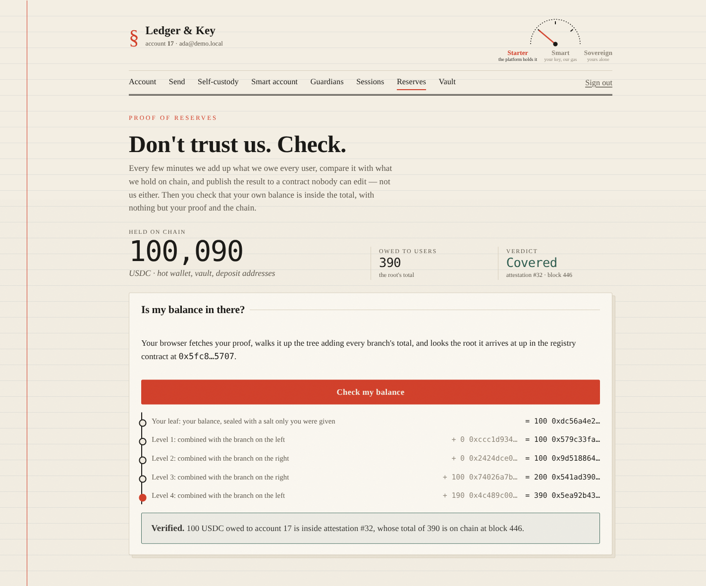
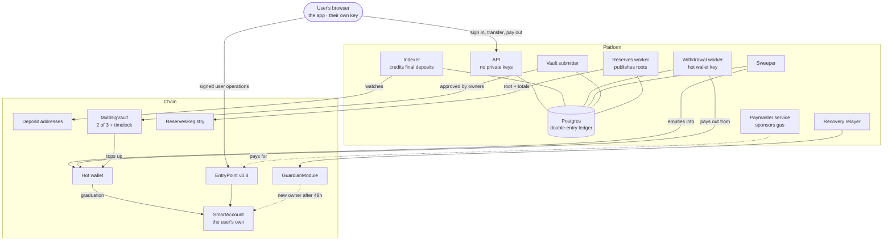

# Ledger & Key

**A custodial crypto wallet with a door out.** Users start the easy way -- we
hold their USDC, transfers between users are free and instant, nobody sees a
gas fee -- and when they are ready, one flow moves their balance to a smart
account only their own key controls, with guardians in case they lose it. For
as long as we do hold money, anyone can check that we hold all of it.



> **Testnet only.** A learning project. It must never hold third-party funds,
> and it is not a licensed custody service. [What it would take](docs/threat-model.md#known-gaps).

## Five minutes

```bash
./wallet demo up      # Docker is the only requirement; first run takes a few minutes
```

Open <http://localhost:5273>, open an account, and press the devnet faucet.
Then follow the money:

1. **Account** -- the deposit shows as *arriving*, then *available* once its
   block is final.
2. **Send** -- to another user, inside the ledger; or out to any address, on
   chain.
3. **Self-custody** -- make a key in the browser, deploy your smart account
   with guardians (the platform pays the gas), and move your balance to it.
   The dial at the top moves from *Starter* to *Smart*.
4. **Reserves** -- check that what you are owed is inside the total the
   platform published on chain. Your browser does the checking.

`./wallet demo down` stops it. `./wallet e2e` drives every one of these flows,
and more, in a real browser.

## How it fits together



**Custody as a dial, not a switch.** While the platform holds a balance, the
ledger is the source of truth and the reserves sit in the hot wallet and a
multisig vault. Once a user graduates, the balance is in their own account:
the platform can pay its gas, and can do nothing else with it.

**Every key in one place, and only one.** The API derives deposit addresses
from an xpub and holds no private key. Each worker holds exactly the key it
needs, and every one refuses to start if two roles share a key.

## Four things worth a look

1. **A reorg that loses no money.** A deposit is spendable only once its block
   is final; if the block disappears first, the deposit is reversed and the
   indexer rewinds. [`chain/reorg.test.ts`](services/api/src/chain/reorg.test.ts)
   induces one on anvil.
2. **Twenty withdrawals at once, no nonce twice.** Nonces come from the
   database, not the node, and a stuck transaction is replaced at its own
   nonce. [`chain/nonce.test.ts`](services/api/src/chain/nonce.test.ts),
   [`chain/withdrawal-worker.test.ts`](services/api/src/chain/withdrawal-worker.test.ts).
3. **Twelve multisig attacks that drained real funds**, each refused.
   [`MultisigVault.attacks.t.sol`](contracts/test/vault/MultisigVault.attacks.t.sol)
   -- and the same for the smart account, its session keys, the paymaster and
   the guardian module.
4. **Proof of reserves anyone can check.** A Merkle sum tree over every
   user's balance, its root published on chain, and a verifier that trusts
   only the user's own proof. [`merkle-sum.ts`](packages/shared/src/merkle-sum.ts),
   [`ReservesRegistry.sol`](contracts/src/reserves/ReservesRegistry.sol).

Every contract has 100% line, branch and function coverage, and each phase's
code was mutation-tested: changed on purpose, one defence at a time, until a
test failed -- or the change was shown to make no difference.

## Read more

| | |
| - | - |
| [docs/phases/](docs/phases/README.md) | How it was built, one phase at a time, with what each had to get right |
| [docs/threat-model.md](docs/threat-model.md) | What it protects, from whom, and the gaps still open |
| [docs/security-review.md](docs/security-review.md) | The contracts' review: Slither triaged, a manual checklist, accepted risks |
| [docs/walkthrough.md](docs/walkthrough.md) | The same flows with `curl`, one service at a time |
| [PROJECT.md](PROJECT.md) | The problem, the design, and the roadmap it followed |

## Developing

Docker is the only requirement: Node, npm, Foundry and Postgres run in
containers, and every generated directory -- `node_modules`, `contracts/lib`,
build output -- lives in a Docker volume rather than on the host.

```bash
cp .env.example .env
./wallet install     # npm and Solidity dependencies, into volumes
./wallet up          # Postgres, anvil, the bundler and the API
./wallet migrate     # the schema
./wallet test        # every backend and Solidity test
```

Run `./wallet help` for everything. The ones used most:

| Command | What it does |
| ------- | ------------ |
| `./wallet demo up` / `down` / `logs` | The whole platform with the frontend, on its own devnet and ports |
| `./wallet e2e` | The frontend's end-to-end tests, against the demo |
| `./wallet test` | Backend and Solidity tests |
| `./wallet test-node [group]` | Backend tests: all, or one of `core`, `chain`, `vault`, `aa`, `erc7562`, `graduation` (CI runs them in parallel) |
| `./wallet test-forge` / `coverage` | Solidity tests; coverage of `src/` |
| `./wallet slither` | Static analysis of the contracts |
| `./wallet typecheck` | Type-check the backend and the frontend |
| `./wallet migrate` / `db-reset` / `psql` | The development database |
| `./wallet indexer`, `withdrawer`, `sweeper`, `vault-submitter`, `paymaster`, `recovery-relayer`, `reserves` | Each worker, on its own, against the development stack |
| `./wallet keygen` | An HD wallet, generated offline; prints the mnemonic once |
| `./wallet cast ...` | `cast` against the local chain |

### Layout

```
contracts/src/        Solidity: vault/, aa/ (account, factory, paymaster, guardians), reserves/
contracts/test/       Foundry tests, *.attacks.t.sol among them
db/migrations/        SQL, applied in filename order
packages/shared/      Shared by backend and browser: env, HD keys, the smart-account
                      client, the Merkle sum tree and its verifier
services/api/src/     The API and every worker
  auth/               Passwords, sessions, who may call what
  ledger/             Double-entry core, idempotency, deposits and withdrawals
  chain/              Indexer, reorgs, nonces, payouts, sweeping, rebalancing
  vault/              Proposals, signatures, the submitter
  aa/                 Paymaster policy and service, recovery relayer, session manager
  graduation/         Custody to self-custody
  reserves/           Snapshots, proofs, publishing
  routes/             The HTTP layer
web/                  The frontend (Vite + React) and its Playwright tests
docker/               Dockerfiles, and the demo stack's settings
wallet                The task runner -- the entry point for everything
```

### Notes

**Money is never a float.** Balances are integers in minor units, stored as
`BIGINT` and parsed into JavaScript `BigInt`. Amounts cross the HTTP boundary as
strings, because a JSON number is an IEEE-754 double and silently loses
precision above 2^53.

**Two Postgres traps this codebase hits.** `node-postgres` returns `BIGINT` as a
string, so `pool.ts` installs an int8 parser; and `SUM()` over `BIGINT` returns
`NUMERIC`, which that parser does not cover, so queries cast back with
`::BIGINT` or parse the string. Both produce wrong answers rather than errors.

**No build step on the backend.** Node 26 strips TypeScript types at runtime,
so `tsc` only checks types and the services have no `dist/`.
`erasableSyntaxOnly` rejects syntax that stripping cannot handle (enums,
namespaces, parameter properties). The frontend is the one thing Vite builds.

**Container users are uid 1000**, matching a typical host user, so
bind-mounted files keep their ownership.

**Versions are pinned:** dependencies in the lockfile, `solc` in
`contracts/foundry.toml`, and the bundlers, geth, Slither and Playwright by
image digest. Postgres, Node and Foundry are pinned only by tag -- Foundry's
`latest` least of all -- which is worth tightening.

### Secrets

`.env` and `.env.demo` are gitignored. No private key, mnemonic or API key ever
belongs in this repository; the demo's keys are generated on every
`./wallet demo up` and live only in `.env.demo`.

`WALLET_XPUB` is an extended *public* key: it derives deposit addresses and
cannot move funds. The default in `.env.example`, and the anvil mnemonic in
`docker-compose.yml`, belong to the public Foundry test mnemonic and control
nothing of value. Generate your own with `./wallet keygen` and keep the
mnemonic it prints offline -- it is never written to disk.

Production key material belongs in a KMS or HSM; see the
[threat model](docs/threat-model.md#known-gaps).
