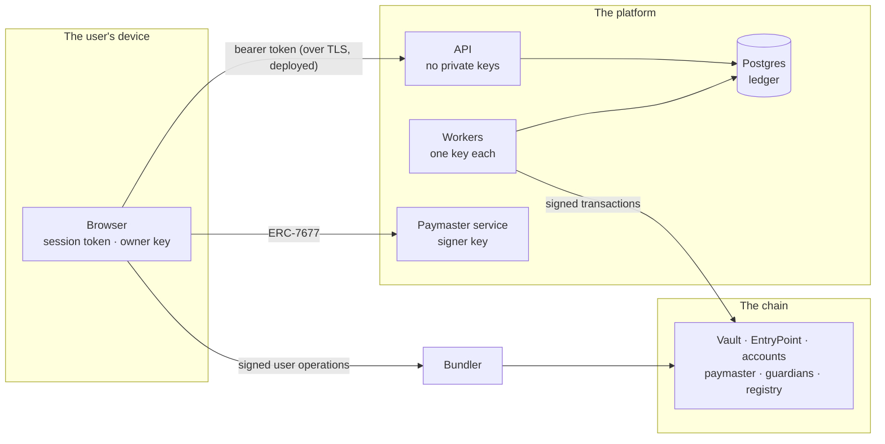

# Threat model

What this wallet protects, from whom, how, and where it still falls short.
Every defence named here is backed by a test; every gap is one the project
knows about and has not closed.

This is a learning project on a devnet. The gaps below are why it must never
hold real funds as it stands.

## What is worth stealing

| Asset | Where it lives | Worst case if lost |
| ----- | -------------- | ------------------ |
| Users' custodial balances | Postgres ledger; the tokens in the hot wallet, the vault and deposit addresses | The platform owes more than it holds |
| Reserves | `MultisigVault` | All custodial balances unbacked |
| Hot wallet key | The withdrawal worker's environment | Everything in the hot wallet -- by design a small slice |
| Deposit mnemonic | The sweeper's environment | Every unswept deposit |
| Paymaster signer key | The paymaster service's environment | The paymaster's gas deposit |
| A graduated user's owner key | That user's browser | That user's smart account |
| Session keys | The session manager (sealed), or the app given one | At most what each session's limits allow |
| The reserves publisher key | The reserves worker's environment | The ability to publish false attestations |
| Sign-in sessions and the admin token | Browsers, the operator | A user's custodial account; the admin endpoints |

## Who is attacking

- **A stranger on the internet**, with the public API and the frontend.
- **Another user** of the platform, signed in, trying to reach someone else's
  account.
- **A thief with one stolen key** -- a worker's, a vault owner's, a guardian's,
  a user's.
- **A dishonest insider**: one vault owner, or the operator holding the admin
  token.
- **The chain itself**: reorgs, a block producer nudging timestamps, a
  bundler that reorders or front-runs.
- **A dishonest platform**, from the user's side: the reason proof of reserves
  and graduation exist.

## Trust boundaries

The API holds **no private key at all**: it derives deposit addresses from an
xpub and refuses an xprv at startup. Every key belongs to exactly one process,
and every process refuses to start if any two roles share a key
(`assertDistinctSigners`).

## STRIDE, component by component

STRIDE names six kinds of threat: **S**poofing (pretending to be someone),
**T**ampering (changing what should not change), **R**epudiation (denying
what was done), **I**nformation disclosure, **D**enial of service, and
**E**levation of privilege.

### The API and the ledger

| Threat | Defence | Proved by |
| ------ | ------- | --------- |
| S: acting as another user | Passwords hashed with scrypt; 256-bit session tokens stored only as SHA-256; every account route checks ownership and answers 404 to anyone else | `routes/auth.test.ts` |
| T: spending one balance twice | Row locks in ascending account order; database-enforced idempotency keys, scoped per user | `ledger/concurrency.test.ts`, `routes/auth.test.ts` |
| T: money created from nothing | Every movement balances to zero in one function; a trigger makes entries append-only; reconciliation answers 500 on drift | `ledger/postings.test.ts`, `routes/ledger.test.ts` |
| T: paying into a system account | Transfers go only between user accounts | `routes/ledger.test.ts` |
| R: a disputed movement | Append-only entries, each tied to a transaction and its idempotency key | `ledger/postings.test.ts` |
| I: reading another's balance or proof | Ownership checks on accounts, entries, graduations and proofs | `routes/auth.test.ts`, `reserves/reserves.test.ts` |
| E: reaching admin endpoints | A separate operator token, compared in constant time | `routes/auth.test.ts` |

### Deposits and payouts

| Threat | Defence | Proved by |
| ------ | ------- | --------- |
| T: a reorg erases a credited deposit | Deposits wait for finality before they are spendable; a vanished block's deposit is reversed | `chain/reorg.test.ts` |
| D: one stuck payout freezing all others | Nonces from the database; stuck transactions replaced at the same nonce; unsendable payouts abandoned and refunded | `chain/withdrawal-worker.test.ts` |
| T: a "successful" transfer that moved nothing | A payout settles only on a matching `Transfer` event | `chain/withdrawal-worker.test.ts` |

### The vault

| Threat | Defence | Proved by |
| ------ | ------- | --------- |
| S, T: forged or replayed approvals | EIP-712 over chain, vault, nonce and deadline; malleable signatures refused; signers strictly ascending | `MultisigVault.attacks.t.sol` |
| E: a stolen quorum emptying the vault at once | A timelock on everything but a daily-capped top-up of the hot wallet; any single owner can cancel | `MultisigVault.t.sol`, `vault/timelock.test.ts` |
| T: reentrancy | `nonReentrant`; the nonce spent before any call | `MultisigVault.attacks.t.sol` |

### Smart accounts, the paymaster and guardians

| Threat | Defence | Proved by |
| ------ | ------- | --------- |
| S: anyone else signing for an account | The owner's EIP-712 signature over the EntryPoint's hash; no platform key can move the funds | `graduation/journey.test.ts`, `SmartAccount.attacks.t.sol` |
| E: a session key exceeding its grant | Target, selector and argument rules checked in validation; spend counted in execution; `approve` counted like a transfer | `SessionKeys.attacks.t.sol`, e2e `accounts.spec.ts` |
| D: draining the paymaster | A policy of exact calls only, a signed sponsorship covering every gas field, a per-account daily cap | `aa/paymaster.test.ts`, `VerifyingPaymaster.attacks.t.sol` |
| E: guardians seizing an account | A quorum, then 48 hours in which the owner sees an alarm and vetoes with one sponsored operation | `GuardianModule.attacks.t.sol`, e2e `accounts.spec.ts` |
| D: an operation that passes simulation and fails on chain | Validation within ERC-7562, checked against an enforcing bundler | `aa/erc7562.test.ts` |

### Proof of reserves

| Threat | Defence | Proved by |
| ------ | ------- | --------- |
| T: understating what is owed | A Merkle sum tree: a branch given less than it holds breaks the hashes for everyone beneath it | `merkle-sum.test.ts` |
| T: showing each user a different root | Roots published to an append-only contract; the verifier computes the root itself and looks it up there | `reserves/publish.test.ts`, e2e `self-custody.spec.ts` |
| I: learning others' balances from a proof | A fresh random salt per user per snapshot; leaves ordered by salted hash | `reserves/reserves.test.ts` |

## Known gaps

Ordered by how much each would matter with real money.

| Gap | Severity | What closing it takes |
| --- | -------- | --------------------- |
| Worker keys live in environment variables | **High** | A KMS or HSM that signs on request, so no process ever holds a key |
| No rate limiting or lockout on sign-in | **High** | Per-account and per-address limits; a second factor |
| A graduated user's owner key sits in the browser's `localStorage` | **High** | A passkey or a hardware key; any script running on the page could read it today |
| The session token sits in `sessionStorage` | Medium | An `HttpOnly` cookie with CSRF protection, and a strict Content-Security-Policy. The page loads no third-party code, which narrows but does not close the risk |
| Payouts settle on the first receipt, not at finality | Medium | Settle only once the payout's block is final, as deposits already do |
| The indexer trusts one RPC node | Medium | Cross-check blocks against a second, independent node |
| Reserves count every address the platform names | Medium | Prove control of each address, e.g. by signing a challenge with it, and publish the list |
| The admin token is a single bearer secret | Medium | Per-operator accounts with roles, and an audit log |
| An active account soon hits the paymaster's daily cap | Low | The cap counts each operation's worst case; count what was actually spent, after the fact, instead |
| Signing up reveals whether an email is registered | Low | Answer every sign-up alike and confirm by email |
| A proof reveals its neighbours' balances, though not whose | Low | Split each balance across several leaves |
| The demo's faucet signs with anvil's unlocked account | Devnet only | Nothing: a real network has no faucet, and the button shows only on chain 31337 |

## Out of scope

The contracts' own review is in [security-review.md](security-review.md).
Network-level threats -- TLS, DNS, the hosting provider -- belong to a
deployment this project does not have.
